<picture>
  <source media="(max-width: 600px)" srcset="./assets/profile-banner-mobile.svg" />
  
</picture>

Saya membantu tim menyambungkan sistem, merapikan data, dan menyederhanakan pekerjaan operasional.

  <a href="#what-i-build"><b>Solusi</b></a> &nbsp;·&nbsp;
  <a href="#featured-work"><b>Proyek</b></a> &nbsp;·&nbsp;
  <a href="#how-i-work"><b>Proses</b></a> &nbsp;·&nbsp;
  <a href="#tech-stack"><b>Tech Stack</b></a> &nbsp;·&nbsp;
  <a href="#github-highlights"><b>GitHub</b></a> &nbsp;·&nbsp;
  <a href="#lets-connect"><b>Kontak</b></a>

## About Me

Saya **Lukman Bijak Bestari**, developer sistem bisnis. Saya membangun aplikasi operasional, menghubungkan sistem yang berbeda, dan merapikan data agar tim bekerja lebih sederhana.

Pengalaman saya mencakup aplikasi untuk **importir, distributor, manufaktur, yayasan pendidikan, dan grup usaha multi-perusahaan**: dari **ERP back-office**, **integrasi sistem akuntansi, pajak, dan akademik**, **konsolidasi keuangan**, hingga **workflow persetujuan** dan **otomatisasi**. Saya juga mendampingi dan melatih tim saat sistem mulai dipakai.

## What I Build

Saya membangun solusi yang mengikuti **alur kerja, data, dan kebutuhan tim Anda** — dari aplikasi operasional hingga otomatisasi dan pelaporan.

<picture>
  <source media="(max-width: 600px)" srcset="./assets/what-i-build-mobile.svg" />
  
</picture>

## Featured Work

| Kebutuhan | Solusi yang dibangun |
|---|---|
| **Rekonsiliasi pajak** | Faktur pajak dicocokkan otomatis dengan data penjualan, selisihnya langsung terlihat dan bisa diekspor. |
| **Konsolidasi keuangan** | Jurnal dari beberapa perusahaan digabung menjadi satu neraca saldo dengan pemetaan akun laporan. |
| **Gateway sistem akademik** | Tagihan dari sistem akademik tercatat otomatis di sistem akuntansi, lengkap dengan retry dan laporan pengecualian. |
| **Anggaran & pembayaran** | Pengajuan anggaran dan pembayaran bertingkat per perusahaan dan departemen, dengan riwayat persetujuan. |
| **Sales force automation** | Sales mengajukan outlet baru dan pelunasan dari lapangan, supervisor menyetujui, data langsung masuk ke sistem. |
| **ERP perdagangan impor** | Deals, kuota impor per negara, dan transaksi PR/SQ/SO/PO dalam satu alur yang terhubung. |

## How I Work

<picture>
  <source media="(max-width: 600px)" srcset="./assets/workflow-mobile.svg" />
  
</picture>

1. **Pahami proses** — petakan kebutuhan, alur kerja, dan sumber data.
2. **Hubungkan sistem** — susun struktur data dan integrasi yang sesuai.
3. **Otomatisasi pekerjaan** — terapkan validasi dan kurangi langkah berulang.
4. **Evaluasi hasil** — gunakan laporan serta masukan tim untuk perbaikan.

## Tech Stack

<picture>
  <source media="(max-width: 600px)" srcset="./assets/tech-stack-mobile.svg" />
  
</picture>

## GitHub Highlights

<a href="https://github.com/lukmanbijak93-blip">
  <picture>
    <source media="(max-width: 600px)" srcset="https://raw.githubusercontent.com/lukmanbijak93-blip/lukmanbijak93-blip/output/github-highlights-mobile.svg" />
    
  </picture>
</a>

### Contribution Snake

<!-- contribution-snake:start -->
<picture>
  <source media="(prefers-color-scheme: dark)" srcset="https://raw.githubusercontent.com/lukmanbijak93-blip/lukmanbijak93-blip/output/github-contribution-grid-snake-dark.svg" />
  
</picture>
<!-- contribution-snake:end -->

## Let's Connect

<a href="https://wa.me/6281285525538">
  <picture>
    <source media="(max-width: 600px)" srcset="./assets/connect-mobile.svg" />
    
  </picture>
</a>

Kita bisa mulai dari kebutuhan integrasi, otomatisasi, pelaporan, atau pelatihan tim.

<a href="https://wa.me/6281285525538">WhatsApp</a> &nbsp;·&nbsp; <a href="https://www.instagram.com/lukmanbi">Instagram @lukmanbi</a> &nbsp;·&nbsp; <a href="https://easyfinancepro.id/">EasyFinancePro</a>

