<picture>
  <source media="(max-width: 600px)" srcset="./assets/profile-banner-mobile.svg" />
  
</picture>

Saya membantu tim menyambungkan sistem, merapikan data, dan menyederhanakan pekerjaan operasional.

  <a href="#what-i-build"><b>Solusi</b></a> &nbsp;·&nbsp;
  <a href="#how-i-work"><b>Proses</b></a> &nbsp;·&nbsp;
  <a href="#tech-stack"><b>Tech Stack</b></a> &nbsp;·&nbsp;
  <a href="#github-highlights"><b>GitHub</b></a> &nbsp;·&nbsp;
  <a href="#lets-connect"><b>Kontak</b></a>

## About Me

Saya **Lukman Bijak Bestari**, trainer dan developer yang menghubungkan proses bisnis, sistem akuntansi, data, dan pengembangan aplikasi. Fokus saya adalah mengubah kebutuhan operasional menjadi solusi digital yang praktis dan mudah digunakan tim.

Keahlian utama saya mencakup **pelatihan dan implementasi Accurate Online**, **integrasi REST API**, **otomatisasi proses bisnis**, serta **pengolahan data dan pelaporan dengan Excel dan SQL**.

## What I Build

Saya membangun solusi yang mengikuti **alur kerja, data, dan kebutuhan tim Anda** — dari aplikasi operasional hingga otomatisasi dan pelaporan.

<picture>
  <source media="(max-width: 600px)" srcset="./assets/what-i-build-mobile.svg" />
  
</picture>

## How I Work

<picture>
  <source media="(max-width: 600px)" srcset="./assets/workflow-mobile.svg" />
  
</picture>

1. **Pahami proses** — petakan kebutuhan, alur kerja, dan sumber data.
2. **Hubungkan sistem** — susun struktur data dan integrasi yang sesuai.
3. **Otomatisasi pekerjaan** — terapkan validasi dan kurangi langkah berulang.
4. **Evaluasi hasil** — gunakan laporan serta masukan tim untuk perbaikan.

## Tech Stack

<picture>
  <source media="(max-width: 600px)" srcset="./assets/tech-stack-mobile.svg" />
  
</picture>

## GitHub Highlights

<a href="https://github.com/lukmanbijak93-blip">
  <picture>
    <source media="(max-width: 600px)" srcset="https://raw.githubusercontent.com/lukmanbijak93-blip/lukmanbijak93-blip/output/github-highlights-mobile.svg" />
    
  </picture>
</a>

### Contribution Snake

<!-- contribution-snake:start -->
<picture>
  <source media="(prefers-color-scheme: dark)" srcset="https://raw.githubusercontent.com/lukmanbijak93-blip/lukmanbijak93-blip/output/github-contribution-grid-snake-dark.svg" />
  
</picture>
<!-- contribution-snake:end -->

## Let's Connect

<a href="https://wa.me/6281285525538">
  <picture>
    <source media="(max-width: 600px)" srcset="./assets/connect-mobile.svg" />
    
  </picture>
</a>

Kita bisa mulai dari kebutuhan integrasi, otomatisasi, pelaporan, atau pelatihan tim.

<a href="https://wa.me/6281285525538">WhatsApp</a> &nbsp;·&nbsp; <a href="https://www.instagram.com/lukmanbi">Instagram @lukmanbi</a> &nbsp;·&nbsp; <a href="https://easyfinancepro.id/">EasyFinancePro</a>

